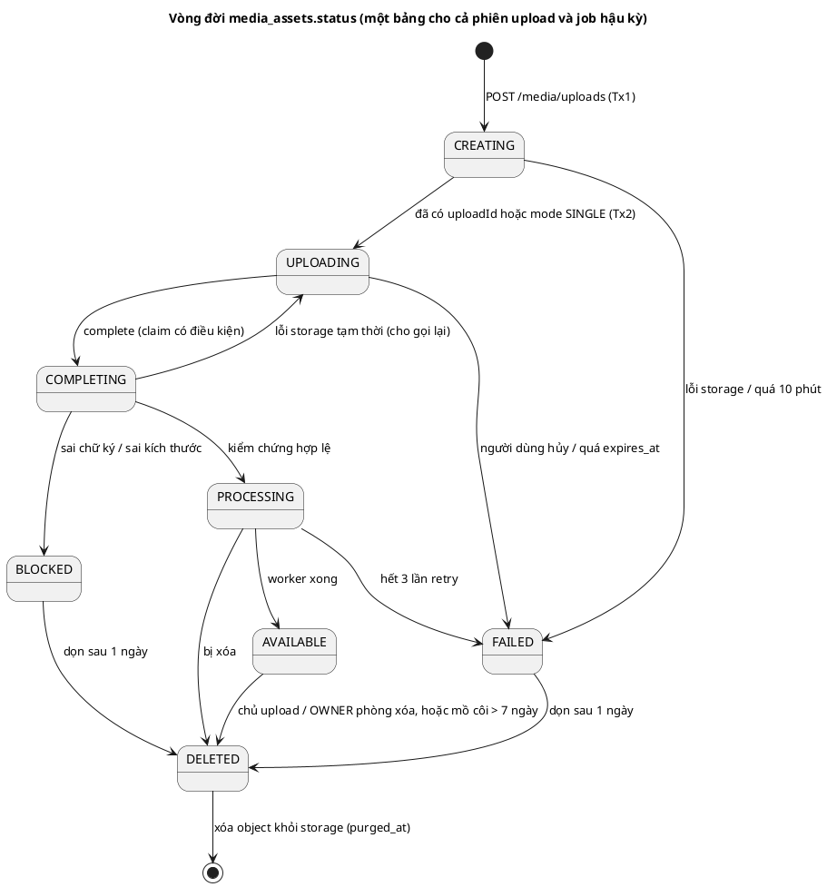
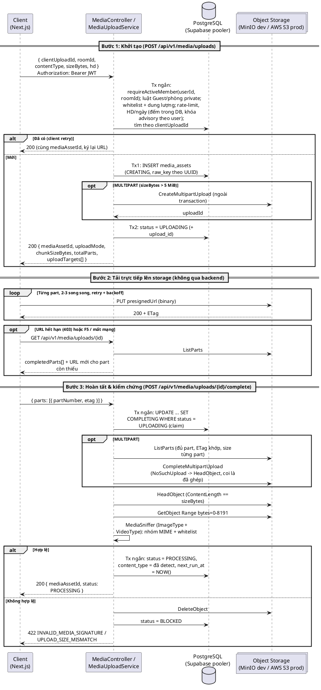
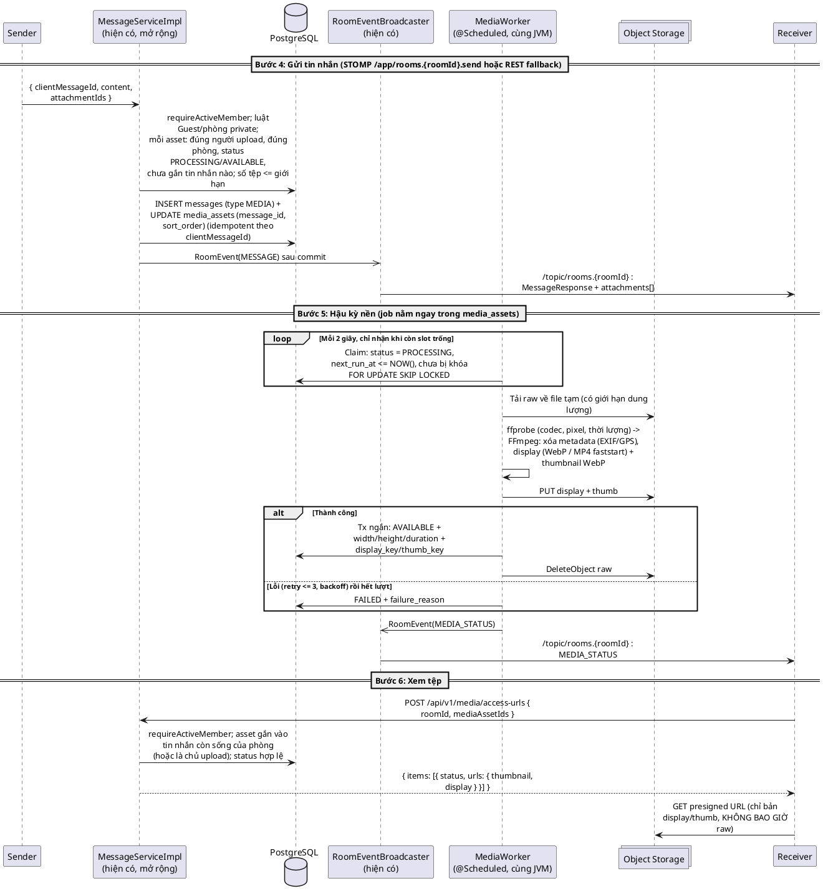

# THIẾT KẾ: UPLOAD ẢNH / VIDEO TRONG PHÒNG CHAT (ChattingSystem) — v4

> Viết dựa trên `REPO_FACTS.md` (repo thật), thay cho các bản thiết kế trước vốn dựa trên giả định. Mỗi quyết định đều có **lý do** và **đánh đổi** để bạn hiểu vì sao chọn.
> Cách đọc: Mục 1–2 giải thích *vì sao*. Mục 3–8 là đặc tả để agent code. Mục 9 là kế hoạch giao việc và các rủi ro đã biết.

## 0. Bài toán và giải pháp trong 8 câu

**Bài toán:** thành viên trong phòng chat (`PUBLIC` hoặc `PRIVATE`) gửi được một hoặc nhiều ảnh/video kèm chữ; tệp lớn thì tải được, lỗi mạng thì thử lại/tiếp tục được; người trong phòng xem được; có thể xóa.

1. Tệp **không đi qua backend**: backend chỉ cấp "giấy phép tạm" (Presigned URL) để trình duyệt tải thẳng lên Object Storage.
2. Tệp lớn được **cắt mảnh 5 MiB** (multipart) để mỗi mảnh retry được và tiếp tục được; tệp ≤ 5 MiB tải một lần.
3. Khi tải xong, backend **kiểm chứng** (đủ mảnh, đúng dung lượng, đúng loại tệp theo nội dung thật) rồi mới chấp nhận.
4. Một **worker nền** xử lý từng tệp bằng FFmpeg: **xóa EXIF/GPS**, chuẩn hóa định dạng, tạo thumbnail. Chỉ bản đã xử lý được phục vụ; bản gốc bị xóa.
5. Tin nhắn chứa `attachmentIds`; backend kiểm tra từng tệp thuộc đúng người, đúng phòng rồi gắn vào tin nhắn.
6. Tin nhắn và trạng thái xử lý được đẩy realtime qua cơ chế **STOMP/`RoomEvent` hiện có**.
7. Người xem xin URL xem tạm qua API; backend kiểm tra họ **đang là thành viên** và tệp **thuộc phòng đó**.
8. Một cronjob mỗi giờ dọn tệp lỗi, tệp chưa bao giờ được gửi, và tệp đã xóa.

---

## 1. Repo hiện có gì, và nó buộc thiết kế phải thế nào

| # | Sự thật trong repo (REPO_FACTS) | Hệ quả cho thiết kế |
| :--- | :--- | :--- |
| 1 | Context-path `/api/v1`; JWT nội bộ HS256 với claim `userId`; controller lấy `@AuthenticationPrincipal Jwt`. **Guest là một dòng trong `users` với `role='GUEST'`** (A3, A2) | Dùng **một cột `uploader_id → users(id)`** cho cả User lẫn Guest. Không cần tách `owner_id`/`guest_id`. Endpoint mới chỉ khai trong `@RequestMapping("/media")` |
| 2 | Bảng phòng là **`chat_rooms`**, thành viên là `room_members`; migration mới nhất là **V9** (A2) | Migration mới là **`V10__media_uploads.sql`**, khóa ngoại tới `chat_rooms(id)`. `ddl-auto: validate` nên entity phải khớp từng cột |
| 3 | `messages.type` có `CHECK ('TEXT','SYSTEM')`, `content VARCHAR(2000) NOT NULL`, idempotency `UNIQUE (sender_id, client_message_id)` (A2, A5) | Thêm `MEDIA` vào CHECK. Tin chỉ có media lưu `content = ''` (không phải sửa NOT NULL, ít đụng entity). Tái dùng idempotency có sẵn |
| 4 | Quyền phòng qua `RoomAccessService.requireActiveRoom/requireActiveMember`. Guest **bị chặn ở phòng private** (`LOGIN_REQUIRED_TO_CHAT`). Phòng hết hạn → `ROOM_EXPIRED` (A4) | **Gọi lại** các hàm này, không tự viết lại luật. Matrix quota chỉ còn: User ở private/public, Guest ở public |
| 5 | WebSocket dùng **Simple Broker trong bộ nhớ, chỉ đúng khi chạy 1 instance**; phát tin qua `RoomEvent` → `RoomEventBroadcaster` (`@TransactionalEventListener(fallbackExecution=true)`) → `/topic/rooms.{roomId}` (A5) | Worker **phải chạy cùng JVM** với backend để dùng lại `RoomEvent`. Tách worker ra process riêng sẽ làm mất realtime |
| 6 | Chưa có `@Scheduled`, `@EnableAsync`, ShedLock, Actuator, Testcontainers. HikariCP mặc định 10. Supabase **Transaction Pooler** cổng 6543, `prepareThreshold=0` (A7, A8, B4, B5) | Thêm `@EnableScheduling`. Dùng khóa advisory **mức transaction** (`pg_try_advisory_xact_lock`) và `FOR UPDATE SKIP LOCKED`, vì khóa mức session không an toàn qua transaction pooler. **Không giữ connection DB khi gọi storage/FFmpeg**. Không thêm hạ tầng mới |
| 7 | **Redis đã cấu hình nhưng chưa được dùng ở đâu** (`RedisService` không ai gọi), mặc định `localhost` (A7) | Quota và rate-limit làm **bằng PostgreSQL**, không dùng Redis/Lua |
| 8 | Storage hiện có: **Cloudflare R2 công khai** cho ảnh blog, biến `STORAGE_*`, bean `S3Client` được inject theo kiểu, upload **qua backend** ≤ 5 MB (A9, B1) | Media chat dùng **bucket riêng, private**, biến **`MEDIA_STORAGE_*`**, **không đăng ký thêm bean `S3Client`** thứ hai (sẽ gây lỗi trùng bean với `S3StorageServiceImpl`). Không đụng code blog |
| 9 | Deploy trên **Railway** (Dockerfile `eclipse-temurin:25-jre`, `-XX:MaxRAMPercentage=75`), không CI/k8s (B2) | Không có IAM Role → prod dùng **IAM user + khóa tĩnh** trong biến Railway. Dockerfile phải **cài ffmpeg**. FFmpeg chạy ngoài heap nên 75% RAM cho heap là quá cao |
| 10 | Frontend là **Next.js, repo riêng**; origin: `localhost:3000/5173`, `192.168.50.199:3000`, `chatchit.me`, `www.chatchit.me` (B3) | Đây là danh sách origin cho **CORS của bucket**. Không dùng `next/image` cho URL ký tạm |
| 11 | JWT access token **15 phút**, `JWT_REFRESH_EXPIRATION` có nhưng **chưa có endpoint refresh** (B6, CHƯA XÁC ĐỊNH #4) | Upload dài hơn 15 phút sẽ gặp 401 lúc `complete`. Xem rủi ro R1 ở Mục 9 |
| 12 | Sản phẩm cam kết **bảo mật vị trí tuyệt đối** (tâm phòng bị làm mờ, không bao giờ gửi tọa độ chính xác) (B6) | Ảnh/video điện thoại **chứa GPS trong metadata** → nếu không xóa thì chính tính năng upload phá lời cam kết này. Xóa metadata **ở server**, không tin client |
| 13 | AWS SDK `2.56.0` (BOM), HTTP client `apache5-client` có sẵn (runtime), không có Tika (A10) | Không nâng SDK, không thêm HTTP client, **không thêm Tika** |
| 14 | Thực nghiệm Phần C **chưa chạy** (Docker không hoạt động) (C) | Thiết kế **không phụ thuộc** vào kết quả 3 câu hỏi chưa kiểm chứng; chúng được đưa vào bài kiểm thử đầu tiên (Mục 9) |
| 15 | **Không có** xóa tin nhắn, đuổi thành viên, xóa phòng (A4, A5) | "Xóa media" = chủ upload hoặc OWNER phòng xóa tệp; mọi tệp mồ côi do cronjob dọn |

---

## 2. Các quyết định kiến trúc: chọn gì, vì sao, đánh đổi gì

**D1. Tải trực tiếp lên storage bằng Presigned PUT, không qua backend.**
*Vì sao:* repo hiện upload qua backend với giới hạn 5 MB (multipart 5/6 MB), pool DB chỉ 10 kết nối, chạy trên container Railway nhỏ. Một video 200 MB đi qua backend sẽ chiếm RAM, băng thông và thread. *Đánh đổi:* phức tạp hơn (cần phiên upload, CORS, kiểm chứng sau khi tải). Chọn **PUT** thay vì POST policy vì chỉ PUT hỗ trợ multipart (cần cho resume); xem R4 về việc PUT không giới hạn dung lượng ở URL.

**D2. Multipart 5 MiB cho tệp lớn, một lần PUT (`SINGLE`) cho tệp ≤ 5 MiB.**
*Vì sao:* mỗi mảnh retry độc lập, rớt mạng chỉ mất một mảnh; 5 MiB là mức tối thiểu của S3 cho mọi mảnh trừ mảnh cuối. Ảnh nhỏ không đáng tốn 3 lời gọi storage. *Đánh đổi:* hai nhánh code, nhưng cùng một kiểu `PUT` nên client dùng chung một hàm.

**D3. Bucket riêng, private, cấu hình `MEDIA_STORAGE_*`; dev = MinIO, prod = AWS S3.**
*Vì sao:* bucket R2 của blog **công khai** (`STORAGE_PUBLIC_BASE_URL`, `Cache-Control: public, immutable`); để tệp chat vào đó là lộ toàn bộ. Dùng tiền tố biến mới để không đụng cấu hình blog. Prod là AWS S3 theo yêu cầu của bạn; vì deploy ở Railway nên dùng khóa IAM tĩnh với quyền tối thiểu. *Đánh đổi:* hai storage cùng tồn tại. *Lưu ý:* MinIO Community đã bị archive, chỉ dùng cho dev và phải pin tag image.

**D4. Xử lý ở server: mọi ảnh/video đều qua FFmpeg, xóa metadata, chỉ phục vụ bản đã xử lý, xóa bản gốc.**
*Vì sao:* xem dòng 12 ở Mục 1. Phía client chỉ là gợi ý, không đáng tin. Làm một lần ở server cũng cho ra định dạng thống nhất (ảnh WebP, video MP4 H.264) mà mọi trình duyệt phát được, và tiết kiệm dung lượng vì không giữ bản gốc. *Đánh đổi:* tốn CPU (xem R3), không còn "ảnh gốc 100%".

**D5. Nhận diện loại tệp bằng `ImageType` có sẵn + `VideoType` mới + `ffprobe`; không thêm Tika.**
*Vì sao:* repo đã có `ImageType.detect()` (JPEG/PNG/GIF/WEBP/AVIF) kèm test. Sau khi bỏ tài liệu khỏi phạm vi (D9), chỉ còn thêm nhận diện `MP4/MOV` (chữ ký `ftyp`). Chữ ký chỉ là bộ lọc rẻ; **`ffprobe` ở worker mới là bước xác thực thật** (đọc được luồng hay không). Không thêm thư viện nghĩa là không có thêm bề mặt lỗ hổng (Tika từng có CVE 10.0 năm 2025). *Đánh đổi:* tự viết `VideoType` (nhỏ, có unit test).

**D6. Duy nhất một bảng `media_assets` chứa cả phiên upload, job hậu kỳ lẫn liên kết tin nhắn (bỏ hoàn toàn bảng `message_attachments`).**
*Vì sao:* một lần upload ↔ một tệp ↔ một job, nên tách thành 3 bảng chỉ thêm máy trạng thái và khóa ngoại. Gộp lại còn **một máy trạng thái** (8 trạng thái, Mục 4) và một chỗ để GC quét. *Đánh đổi:* vài cột nullable sau khi upload xong (`upload_id`, `chunk_size_bytes`).

**D7. Job queue ngay trong PostgreSQL (`SKIP LOCKED`), worker chạy cùng JVM bằng `@Scheduled` + pool giới hạn.**
*Vì sao:* repo không có message queue, Actuator hay ShedLock; thêm RabbitMQ/Redis Streams là thêm hạ tầng phải vận hành. Sự kiện lưu trong DB nên **sống sót qua restart** (Railway tự restart khi lỗi). `SKIP LOCKED` an toàn cả khi Railway chạy hai instance chồng nhau lúc deploy. Pool giới hạn vì FFmpeg ăn CPU/RAM. *Đánh đổi:* poll mỗi 2 giây, không "đẩy" tức thì; không scale ngang được (nhưng broker WebSocket hiện tại cũng không).

**D8. Quota HD, rate-limit và giới hạn phiên mở đếm bằng PostgreSQL, không dùng Redis.**
*Vì sao:* Redis chưa có nơi nào dùng nên chưa chắc đã được cấp ở prod. Đếm trong DB, **cùng transaction** với việc tạo bản ghi, nên không có lỗi "trừ lượt rồi quên hoàn" (lỗi hay gặp với bộ đếm Redis). Phiên lỗi/hủy không tính nên không cần logic hoàn lượt. *Đánh đổi:* thêm vài truy vấn `COUNT` (có index, lưu lượng thấp).

**D9. MVP chỉ ảnh và video. Không dedup, không BlurHash, không SHA-256 phía client, không tài liệu.**
*Vì sao:* yêu cầu là ảnh/video. Tài liệu (pdf/zip/office) không thể xóa metadata, không có quét virus, và cần phát hiện định dạng phức tạp, tức là thêm rủi ro mà không thêm giá trị cho phòng chat theo vị trí. Dedup làm phát sinh cả nhóm lỗi (race, rò quota, hash do client khai) cho lợi ích nhỏ. BlurHash thêm một thư viện client và một chuỗi cần kiểm tra. *Đánh đổi:* gửi lại cùng ảnh thì tải lại; khung chờ không có ảnh mờ. Đều thêm lại được sau khi có số liệu.

**D10. Mở rộng contract chat hiện có thay vì tạo kênh riêng.**
*Vì sao:* client đã biết gửi tin qua `/app/rooms.{roomId}.send` (hoặc REST), nhận tin qua `/topic/rooms.{roomId}`. Chỉ thêm trường `attachmentIds` (request) và `attachments` (response), cùng một loại sự kiện `MEDIA_STATUS`. Thay đổi mang tính **cộng thêm** nên client cũ không hỏng. *Đánh đổi:* `MessageServiceImpl.send` dài hơn; tách phần kiểm tra tệp đính kèm sang `MediaAccessService`.

**D11. Cấp URL xem theo lô, kiểm tra thành viên và việc tệp thuộc tin nhắn của phòng.**
*Vì sao:* `access-url` chỉ kiểm tra "là thành viên" là chưa đủ vì ID tăng dần: thành viên có thể duyệt ID để xem tệp **chưa gửi** của người khác. Màn hình chat cần nhiều tệp cùng lúc nên một request theo lô. Dùng lại `requireActiveMember` nên rời phòng hoặc phòng hết hạn là mất quyền xem ngay.

---

## 3. Phạm vi và quy tắc nghiệp vụ

**Làm:** ảnh (JPEG, PNG, WebP, AVIF, GIF) và video (MP4, MOV) trong tin nhắn của phòng PUBLIC/PRIVATE; nhiều tệp mỗi tin; tải mảnh có retry/tiếp tục; xem có kiểm soát quyền; xóa media.
**Chưa làm (có thể thêm sau):** tài liệu/zip, dedup, BlurHash, CDN, nhiều instance backend, quét virus/kiểm duyệt nội dung, xóa tin nhắn, chính sách dọn media của phòng đã hết hạn (cần bạn chốt, xem R6).

### 3.1. Giới hạn theo vai trò (cấu hình được trong `media.limits.*`)

| | User — phòng PRIVATE | User — phòng PUBLIC | Guest — phòng PUBLIC |
| :--- | :--- | :--- | :--- |
| Dung lượng ảnh / video tối đa | 25 MB / 100 MB | 20 MB / 50 MB | 5 MB / 20 MB |
| Số tệp mỗi tin nhắn | 10 | 5 | 2 |
| Chất lượng HD (`hd: true`, chỉ ảnh) | Không giới hạn | Tối đa **5 lượt/ngày** | **Cấm** (`ACCESS_DENIED`) |
| `init` tối đa / phút | 30 | 30 | 10 |
| Số lần upload đang mở cùng lúc | 10 | 10 | 3 |

* **Quy tắc thời lượng Video:** Video **KHÔNG giới hạn thời lượng (số phút)**, chỉ kiểm soát chặt theo **dung lượng tệp (`sizeBytes`)**. Cột `duration_ms` đo qua `ffprobe` chỉ phục vụ lưu trữ metadata để hiển thị nhãn thời gian trên giao diện chat.
* **Quy tắc trần dung lượng Video:** Đã hạ trần an toàn (Private: 100 MB thay vì 200 MB; Public: 50 MB thay vì 100 MB) để bảo vệ Worker FFmpeg khỏi nguy cơ nghẽn hàng đợi (Queue Jam) và chống cạn kiệt ổ đĩa tạm `/tmp/media-work`.

* Guest ở phòng PRIVATE: đã bị chặn sẵn bởi luật hiện có (`LOGIN_REQUIRED_TO_CHAT`), tái dùng nguyên mã lỗi đó.
* "Ngày" của quota HD tính theo múi giờ khai báo `media.quota.zone` (mặc định `Asia/Ho_Chi_Minh`), không theo múi giờ máy chủ (Railway thường là UTC).
* Mọi giới hạn kiểm tra **hai lần**: lúc `init` (theo giá trị khai) và lúc `complete` (theo giá trị đo/detect thật).

### 3.2. Định dạng chấp nhận và bản đầu ra

| Loại | Chấp nhận (theo nội dung thật) | Bản được phục vụ (`display`) | Thumbnail |
| :--- | :--- | :--- | :--- |
| Ảnh tĩnh | `image/jpeg`, `png`, `webp`, `avif` | **WebP**, cạnh dài ≤ 2048 px, chất lượng 82 (HD: ≤ 4096 px, 92). Xóa metadata | WebP ≤ 300 px |
| GIF | `image/gif` | Giữ nguyên (GIF không có EXIF theo chuẩn) | WebP khung đầu |
| Video | `video/mp4`, `video/quicktime` | **MP4 H.264/AAC** `+faststart`, cạnh dài ≤ 1920 px. Đã là H.264+AAC thì chỉ remux (rẻ), còn lại mới transcode. Xóa metadata | WebP ≤ 300 px, khung giây 1 |

* **Không nhận HEIC/HEIF**: frontend chuyển sang JPEG trước khi tải (trình duyệt không đọc HEIC, và server không nên gánh việc đó).
* Lý do chọn đầu ra thống nhất: mọi trình duyệt hiện đại đều phát WebP và MP4 H.264; WebM/MKV bị loại vì Safari/iOS không ổn định.

---

## 4. Luồng xử lý

### 4.1. Máy trạng thái của `media_assets`

Mọi chuyển trạng thái là `UPDATE ... WHERE status = :expected`. Nếu 0 dòng bị ảnh hưởng thì đọc lại trạng thái hiện tại và trả kết quả tương ứng. Đây là cách làm cho `complete`/hủy/GC **an toàn khi bị gọi lặp hoặc chạy đồng thời** (bấm đúp, hai tab, retry sau khi mất response, cronjob chạy lúc đang `complete`).



### 4.2. Upload: khởi tạo, tải mảnh, hoàn tất



**Vì sao các bước này như vậy:**
* `INSERT` bản ghi **trước**, gọi storage **sau**, rồi mới cập nhật: nếu storage lỗi thì có bản ghi để GC thấy và dọn. Làm ngược lại thì để lại multipart mồ côi không ai biết tới.
* Hai transaction ngắn tách rời lời gọi storage: connection Hikari (chỉ 10) không bị giữ trong lúc chờ mạng.
* `clientUploadId` do client sinh và giữ nguyên khi retry: request đầu thành công nhưng mất response thì lần gọi lại **không tạo phiên mới**.
* Kiểm tra `ListParts` + `HeadObject` vì **PUT không giới hạn được dung lượng ở URL**: server tự đối chiếu sau khi tải (R4).
* `NoSuchUpload` khi `complete` lặp lại: lần trước đã ghép thành công nhưng chưa kịp ghi DB, nên coi như đã ghép (`HeadObject`) thay vì báo lỗi mãi.

### 4.3. Gửi tin nhắn, hậu kỳ và xem tệp



**Vì sao các bước này như vậy:**
* Tệp **chỉ gắn được vào một tin nhắn** (`UNIQUE (media_asset_id)`), đúng người upload, đúng phòng: chặn đính kèm tệp của người khác hoặc dùng lại tệp ở phòng khác.
* Worker không giữ connection DB trong lúc chạy FFmpeg; chỉ có hai transaction ngắn (claim và ghi kết quả).
* Sự kiện `MEDIA_STATUS` chỉ là **gợi ý**: nó có thể đến trước tin nhắn hoặc bị mất. Client phải coi `status` trong `access-urls` là nguồn sự thật (Mục 6).

---

## 5. Thiết kế dữ liệu

### 5.1. Migration `V10__media_uploads.sql`

Chốt dùng **DUY NHẤT 1 bảng mới là `media_assets`** (bỏ hoàn toàn bảng `message_attachments`, KHÔNG tạo entity `MessageAttachment` hay `MessageAttachmentRepository`).
Theo đúng quy ước hiện có: `BIGINT GENERATED BY DEFAULT AS IDENTITY`, `TIMESTAMP WITH TIME ZONE`, enum là `VARCHAR` + `CHECK`, snake_case, tên bảng số nhiều. Dự án bật `ddl-auto: validate` nên entity phải khớp chính xác từng cột và kiểu dữ liệu.

```sql
-- V10__media_uploads.sql

-- 1) Cho phép loại tin nhắn MEDIA (media-only: content = chuỗi rỗng, giữ NOT NULL hiện có)
ALTER TABLE messages DROP CONSTRAINT chk_messages_type;
ALTER TABLE messages ADD CONSTRAINT chk_messages_type CHECK (type IN ('TEXT', 'SYSTEM', 'MEDIA'));

-- 2) media_assets: DUY NHẤT 1 bảng quản lý toàn bộ tệp, phiên upload, thứ tự đính kèm và job hậu kỳ
CREATE TABLE media_assets (
    id               BIGINT GENERATED BY DEFAULT AS IDENTITY PRIMARY KEY,
    uploader_id      BIGINT        NOT NULL REFERENCES users (id),
    room_id          BIGINT        NOT NULL REFERENCES chat_rooms (id),
    message_id       BIGINT        REFERENCES messages (id) ON DELETE SET NULL,
    sort_order       INTEGER,
    client_upload_id UUID          NOT NULL,
    kind             VARCHAR(10)   NOT NULL,
    quality          VARCHAR(10)   NOT NULL DEFAULT 'STANDARD',
    status           VARCHAR(20)   NOT NULL,
    content_type     VARCHAR(100)  NOT NULL,
    size_bytes       BIGINT        NOT NULL,
    upload_id        VARCHAR(1024),
    raw_key          VARCHAR(500)  NOT NULL,
    display_key      VARCHAR(500),
    thumb_key        VARCHAR(500),
    width            INTEGER,
    height           INTEGER,
    duration_ms      INTEGER,
    attempts         INTEGER       NOT NULL DEFAULT 0,
    next_run_at      TIMESTAMP WITH TIME ZONE,
    locked_until     TIMESTAMP WITH TIME ZONE,
    last_error       VARCHAR(500),
    deleted_at       TIMESTAMP WITH TIME ZONE,
    created_at       TIMESTAMP WITH TIME ZONE NOT NULL DEFAULT now(),
    updated_at       TIMESTAMP WITH TIME ZONE NOT NULL DEFAULT now(),
    CONSTRAINT uk_media_assets_client_upload        UNIQUE (uploader_id, client_upload_id),
    CONSTRAINT uk_media_assets_raw_key              UNIQUE (raw_key),
    CONSTRAINT uk_media_assets_message_order        UNIQUE (message_id, sort_order),
    CONSTRAINT chk_media_assets_sort_order          CHECK (sort_order IS NULL OR sort_order >= 0),
    CONSTRAINT chk_media_assets_sort_order_required CHECK (message_id IS NULL OR sort_order IS NOT NULL),
    CONSTRAINT chk_media_assets_kind                CHECK (kind IN ('IMAGE', 'VIDEO')),
    CONSTRAINT chk_media_assets_quality             CHECK (quality IN ('STANDARD', 'HD')),
    CONSTRAINT chk_media_assets_status              CHECK (status IN
        ('CREATING', 'UPLOADING', 'COMPLETING', 'PROCESSING', 'AVAILABLE',
         'FAILED', 'BLOCKED', 'DELETED', 'PURGED')),
    CONSTRAINT chk_media_assets_size                CHECK (size_bytes > 0)
);

CREATE INDEX idx_media_assets_uploader_created ON media_assets (uploader_id, created_at DESC);
CREATE INDEX idx_media_assets_job_claim        ON media_assets (next_run_at) WHERE status = 'PROCESSING';
CREATE INDEX idx_media_assets_status_created   ON media_assets (status, created_at);
CREATE INDEX idx_media_assets_deleted_purge    ON media_assets (deleted_at) WHERE status = 'DELETED';
```

**Ưu điểm và đặc điểm kỹ thuật của thiết kế đã chốt:**
* **Bỏ bảng trung gian `message_attachments`:** Nhúng trực tiếp `message_id` và `sort_order` vào bảng `media_assets`. Lúc mới upload xong, `message_id` và `sort_order` là `NULL`. Khi gửi tin nhắn, cập nhật `message_id` và `sort_order` tương ứng.
* **Tự động tối ưu Index truy vấn tin nhắn:** Ràng buộc `uk_media_assets_message_order UNIQUE (message_id, sort_order)` tự sinh một chỉ mục B-Tree composite `(message_id, sort_order)`. Nhờ đó, truy vấn lấy toàn bộ ảnh/video của một trang tin nhắn (`WHERE message_id IN (...) ORDER BY sort_order`) chạy cực nhanh mà không cần JOIN và không cần tạo thêm index phụ.
* **Bảo vệ toàn vẹn thứ tự đính kèm:** `chk_media_assets_sort_order_required` đảm bảo nếu file đã gắn vào tin nhắn thì bắt buộc phải có `sort_order` (≥ 0); ngược lại nếu chưa gắn tin nhắn thì `sort_order` là `NULL`.
* **Idempotency chuẩn xác theo User:** Khóa `UNIQUE (uploader_id, client_upload_id)` đảm bảo tính lũy đẳng chuẩn xác cho từng người dùng, ngăn chặn việc tạo trùng lặp phiên tải lên khi mạng bị chập chờn.
* **Cắt giảm tối đa các cột dư thừa:** Đã loại bỏ các cột không cần thiết (`chunk_size_bytes`, `total_parts`, `upload_mode`, `declared_content_type`, `failure_reason`, `purged_at`) giúp bản ghi tinh gọn, giảm dung lượng lưu trữ đĩa và tăng tốc độ đọc ghi.

### 5.2. Thay đổi code của `message` (hiện có)

* `MessageType` thêm `MEDIA`. `Message` thêm static factory `Message.media(roomId, senderId, clientMessageId, caption)` (đúng phong cách `Message.text(...)`), `caption` null thì lưu `''`.
* Quy tắc kiểm tra mới trong `MessageServiceImpl.send`: nội dung rỗng chỉ hợp lệ khi có ít nhất một `attachmentId`; vẫn giới hạn 2000 ký tự.
* Khi gửi tin nhắn: Gán `message_id` và `sort_order = position` trực tiếp vào `media_assets` (`UPDATE media_assets SET message_id = :messageId, sort_order = :position WHERE id = :assetId`).
* `MessageResponse` thêm `attachments` (mảng rỗng với tin chữ). Khi trả lịch sử tin nhắn, **lấy attachments của cả trang bằng một truy vấn duy nhất** (`SELECT * FROM media_assets WHERE message_id IN (:messageIds) ORDER BY sort_order ASC`) để tránh triệt để vấn đề N+1.

### 5.3. Các truy vấn quan trọng (để agent hiện thực bằng JPQL/native)

```sql
-- 1) Đếm lượt HD trong ngày (trong cùng transaction với INSERT; trước đó lấy pg_advisory_xact_lock theo user)
SELECT count(*) FROM media_assets
 WHERE uploader_id = :userId AND quality = 'HD'
   AND created_at >= :startOfDay AND status NOT IN ('FAILED', 'BLOCKED');

-- 2) Tệp nào trong danh sách thật sự thuộc một tin nhắn còn sống của phòng (kiểm tra quyền xem)
SELECT a.id
  FROM media_assets a
  JOIN messages m ON m.id = a.message_id
 WHERE m.room_id = :roomId AND m.deleted_at IS NULL
   AND a.id IN (:ids);

-- 3) Tệp mồ côi: upload xong nhưng không gắn tin nhắn sống nào quá 7 ngày (cronjob dọn)
SELECT a.id FROM media_assets a
 WHERE a.status IN ('PROCESSING', 'AVAILABLE')
   AND a.created_at < now() - interval '7 days'
   AND (a.message_id IS NULL OR EXISTS (SELECT 1 FROM messages m WHERE m.id = a.message_id AND m.deleted_at IS NOT NULL))
 ORDER BY a.id LIMIT 200 FOR UPDATE OF a SKIP LOCKED;

-- 4) Nhận job hậu kỳ (trong transaction ngắn; :freeSlots = số slot trống của pool)
UPDATE media_assets
   SET attempts = attempts + 1,
       locked_until = now() + interval '15 minutes',
       updated_at = now()
 WHERE id IN (SELECT id FROM media_assets
               WHERE status = 'PROCESSING'
                 AND next_run_at <= now()
                 AND (locked_until IS NULL OR locked_until < now())
               ORDER BY next_run_at
               LIMIT :freeSlots
                 FOR UPDATE SKIP LOCKED)
RETURNING id, attempts;
```

Rate-limit `init` và số upload đang mở cũng là `COUNT(*)` trên `media_assets` theo `uploader_id` (`created_at` trong 1 phút; `status IN ('CREATING','UPLOADING','COMPLETING')`).

---

## 6. Đặc tả API

### 6.1. Quy ước (theo repo hiện có)
* Tất cả đường dẫn dưới context-path `/api/v1` (controller chỉ khai `@RequestMapping("/media")`). Mọi endpoint **cần JWT** (`anyRequest().authenticated()`), **không phải sửa `SecurityConfig`**.
* Lấy người dùng: `@AuthenticationPrincipal Jwt jwt` → `((Number) jwt.getClaim("userId")).longValue()`. Không bao giờ nhận `userId` từ body.
* Trả về `ApiResponse.success(message, data)`; lỗi ném `AppException(ErrorCode.X)`.
* DTO là `record` trong `dto/request`, `dto/response`. Constructor DI viết tay (không `@RequiredArgsConstructor`). `@Transactional` đặt ở `service/impl`; **các method gọi storage không được bọc trong một `@Transactional` duy nhất**.
* Thời gian là `Instant` UTC dạng `...Z` (giống `createdAt` của `MessageResponse`).

### 6.2. `ErrorCode` mới

Thêm vào `ErrorCode.java` theo đúng kiểu `NAME(HttpStatus.X, "thông báo tiếng Việt")`. **Không tái dùng `INVALID_FILE`/`FILE_TOO_LARGE`**: thông báo của chúng đang ghi cứng "chỉ ảnh" và "5 MB" cho tính năng upload ảnh blog.

| Mã | HTTP | Khi nào |
| :--- | :--- | :--- |
| `MEDIA_NOT_FOUND` | 404 | Không có tệp, hoặc người gọi không có quyền (không phân biệt để tránh dò ID) |
| `MEDIA_DELETED` | 410 | Tệp đã bị xóa |
| `MEDIA_NOT_READY` | 409 | Tệp ở trạng thái không cho thao tác (VD đính kèm tệp `FAILED`) |
| `UPLOAD_EXPIRED` | 410 | Quá `expires_at` (24 giờ). **Không** dùng khi chỉ URL ký hết hạn (client xin URL mới) |
| `UPLOAD_IN_PROGRESS` | 409 | Đang `COMPLETING` (request `complete` khác đang chạy), thử lại sau 1–2 giây |
| `UPLOAD_INCOMPLETE` | 409 | Thiếu mảnh hoặc ETag không khớp; client tải bù rồi gọi lại |
| `UPLOAD_SIZE_MISMATCH` | 422 | Kích thước thực ≠ `sizeBytes` đã khai |
| `MEDIA_TOO_LARGE` | 413 | `sizeBytes` vượt giới hạn của vai trò/phòng |
| `UNSUPPORTED_MEDIA_TYPE` | 415 | MIME khai báo không thuộc whitelist của vai trò/phòng |
| `INVALID_MEDIA_SIGNATURE` | 422 | Nội dung tệp không khớp định dạng đã khai |
| `TOO_MANY_ATTACHMENTS` | 422 | Vượt số tệp mỗi tin nhắn |
| `HD_QUOTA_EXCEEDED` | 429 | Hết 5 lượt HD/ngày ở phòng PUBLIC |
| `UPLOAD_RATE_LIMITED` | 429 | Vượt rate-limit `init` hoặc quá số upload đang mở |

Tái dùng mã có sẵn: `NOT_ROOM_MEMBER`, `ROOM_EXPIRED`, `LOGIN_REQUIRED_TO_CHAT`, `ACCESS_DENIED`, `VALIDATION_ERROR`, `STORAGE_NOT_CONFIGURED`, `STORAGE_ERROR`. (Hằng số HTTP 422 trong Spring 7 có thể tên là `UNPROCESSABLE_CONTENT`; agent kiểm tra khi code.)

### 6.3. Endpoints

#### 1) `POST /api/v1/media/uploads` — khởi tạo

```json
{
  "clientUploadId": "7d9f3b52-1c64-4c1e-9a77-0f6f5c2f8a10",
  "roomId": 12,
  "contentType": "video/mp4",
  "sizeBytes": 12582912,
  "hd": false
}
```

**Xử lý (theo thứ tự):**
1. Lấy `userId`; `roomAccess.requireActiveRoom(roomId)` (để biết `roomType`) và `requireActiveMember(userId, roomId)`.
2. Nếu người dùng là Guest và phòng là private → `LOGIN_REQUIRED_TO_CHAT`. Guest bật `hd` → `ACCESS_DENIED`. `hd` với video → `VALIDATION_ERROR`.
3. `contentType` thuộc whitelist (Mục 3.2) → `kind`; `sizeBytes` ≤ giới hạn của vai trò/phòng (Mục 3.1).
4. **Một transaction ngắn** (lấy `pg_advisory_xact_lock` theo user để hai request đồng thời không cùng vượt giới hạn): kiểm tra rate-limit, số upload đang mở, quota HD; **nếu `clientUploadId` đã có của cùng người dùng thì trả lại bản ghi đó** (ký lại URL); ngược lại `INSERT` (`CREATING`) với `raw_key = raw/{yyyy}/{MM}/{dd}/{uuid}.{ext}` (uuid sinh sẵn, `ext` theo MIME đã whitelist, không lấy từ tên tệp).
5. Ngoài transaction: MULTIPART → `createMultipartUpload` (đặt `Content-Type` do server quyết định, **không** đặt `Cache-Control`). Lỗi → `FAILED`, ném `STORAGE_ERROR`.
6. Transaction ngắn: `UPLOADING` (+ `upload_id`). Ký Presigned PUT (TTL 900 giây) cho từng mảnh.

**Response (MULTIPART):**

```json
{
  "statusCode": 200,
  "message": "Khởi tạo tải lên thành công",
  "data": {
    "mediaAssetId": 301,
    "status": "UPLOADING",
    "kind": "VIDEO",
    "uploadMode": "MULTIPART",
    "chunkSizeBytes": 5242880,
    "totalParts": 3,
    "expiresAt": "2026-11-18T01:15:30Z",
    "urlExpiresInSeconds": 900,
    "uploadTargets": [
      {
        "partNumber": 1,
        "method": "PUT",
        "url": "<storage-host>/<bucket>/raw/2026/11/17/6f1c0d2e-7a41-4c3b-9d52-1e8f0a7b3c64.mp4?partNumber=1&uploadId=abc123&X-Amz-Signature=...",
        "headers": {}
      }
    ]
  }
}
```

`SINGLE`: `uploadMode: "SINGLE"`, `totalParts: 1`, một phần tử `uploadTargets` có `headers` (VD `{ "Content-Type": "image/jpeg" }`) mà client **phải gửi đúng** vì nằm trong chữ ký. `<storage-host>` là `MEDIA_STORAGE_PUBLIC_ENDPOINT` ở dev, hoặc `https://<bucket>.s3.<region>.amazonaws.com` ở prod. Server tự tính `totalParts = ceil(sizeBytes / 5242880)`; client không gửi.

#### 2) `GET /api/v1/media/uploads/{mediaAssetId}` — trạng thái, tiếp tục, ký lại URL

* Chỉ người upload (không phải → `MEDIA_NOT_FOUND`). Quá `expires_at` → `UPLOAD_EXPIRED`. Không còn ở `UPLOADING` thì trả đúng `status` hiện tại, không ký URL.
* Với `UPLOADING`: `listParts` để biết mảnh nào đã lên storage, ký URL mới cho các mảnh còn thiếu.

```json
{
  "statusCode": 200,
  "message": "Lấy trạng thái tải lên thành công",
  "data": {
    "mediaAssetId": 301,
    "status": "UPLOADING",
    "uploadMode": "MULTIPART",
    "chunkSizeBytes": 5242880,
    "totalParts": 3,
    "expiresAt": "2026-11-18T01:15:30Z",
    "urlExpiresInSeconds": 900,
    "completedParts": [
      { "partNumber": 1, "etag": "\"a54357aff0632cce46d942af68356b38\"", "sizeBytes": 5242880 }
    ],
    "remainingUploadTargets": [
      {
        "partNumber": 2,
        "method": "PUT",
        "url": "<storage-host>/<bucket>/raw/2026/11/17/6f1c0d2e-7a41-4c3b-9d52-1e8f0a7b3c64.mp4?partNumber=2&uploadId=abc123&X-Amz-Signature=...",
        "headers": {}
      }
    ]
  }
}
```

#### 3) `POST /api/v1/media/uploads/{mediaAssetId}/complete` — ghép và kiểm chứng

Body với MULTIPART (SINGLE gửi `{}`):

```json
{
  "parts": [
    { "partNumber": 1, "etag": "\"a54357aff0632cce46d942af68356b38\"" },
    { "partNumber": 2, "etag": "\"0c78aef83f66abc1fa1e8477f296d394\"" },
    { "partNumber": 3, "etag": "\"acbd18db4cc2f85cedef654fccc4a4d8\"" }
  ]
}
```

**Xử lý** (bước 1 và 6 là transaction ngắn; 2–5 gọi storage **ngoài** transaction):
1. **Claim:** `UPDATE ... SET status='COMPLETING' WHERE id=? AND uploader_id=? AND status='UPLOADING' AND expires_at > now()`. Thua claim → đọc lại: `PROCESSING/AVAILABLE` → trả `200` kết quả hiện tại; `COMPLETING` → `UPLOAD_IN_PROGRESS`; trạng thái khác → lỗi tương ứng.
2. **Đối chiếu mảnh (MULTIPART):** `listParts`. Thiếu mảnh hoặc ETag không khớp (so sánh sau khi bỏ dấu nháy `"`) → trả về `UPLOADING`, ném `UPLOAD_INCOMPLETE` (client tải bù được). Mảnh sai kích thước (mọi mảnh trừ mảnh cuối phải đúng 5 MiB, tổng phải bằng `size_bytes`) → coi là gian lận: `abortMultipartUpload`, `BLOCKED`, ném `UPLOAD_SIZE_MISMATCH`.
3. **Ghép (MULTIPART):** `completeMultipartUpload`. Gặp `NoSuchUpload` (lần trước đã ghép nhưng chưa kịp ghi DB) → `headObject`, tồn tại thì đi tiếp.
4. **Dung lượng:** `headObject.contentLength == size_bytes`, nếu lệch → `deleteObject`, `BLOCKED`, `UPLOAD_SIZE_MISMATCH`.
5. **Loại tệp:** đọc 8 KiB đầu (`Range: bytes=0-8191`) → `MediaSniffer` (`ImageType.detect` rồi `VideoType.detect`). Phải thuộc whitelist **và cùng nhóm ảnh/video** với `kind`; so theo nhóm và whitelist, không so bằng chuỗi với `contentType` khai báo (VD khai `video/mp4` nhưng chữ ký là QuickTime vẫn hợp lệ). Sai → `deleteObject`, `BLOCKED`, `INVALID_MEDIA_SIGNATURE`.
6. **Chấp nhận:** `status='PROCESSING'`, `content_type` = giá trị đã detect, `next_run_at = now()`, `attempts = 0`.
* Lỗi tạm thời của storage → đưa về `UPLOADING`, ném `STORAGE_ERROR` (client được gọi lại).
* Response: `{ "mediaAssetId": 301, "status": "PROCESSING", "kind": "VIDEO" }`.

#### 4) `DELETE /api/v1/media/{mediaAssetId}` — hủy upload hoặc xóa tệp

| Trạng thái hiện tại | Ai được làm | Kết quả |
| :--- | :--- | :--- |
| `UPLOADING` | Chỉ người upload | `abortMultipartUpload` (hoặc `deleteObject` với SINGLE) → `FAILED` (`USER_ABORTED`) |
| `CREATING`, `COMPLETING` | — | `409 UPLOAD_IN_PROGRESS` (đang chạy dở, thử lại sau) |
| `PROCESSING`, `AVAILABLE`, `FAILED`, `BLOCKED` | Người upload, hoặc `OWNER` của phòng (`MemberRole.OWNER` qua `requireActiveMember`) | `DELETED` + `deleted_at`. Tin nhắn cũ hiển thị "Tệp đã bị xóa" (`MEDIA_DELETED`). Object do cronjob xóa sau 24 giờ |

Idempotent (xóa tệp đã `DELETED` vẫn trả `200`). Quyền xóa cho admin hệ thống để dành cho nhóm `/admin/**` sau này.

#### 5) `POST /api/v1/media/access-urls` — cấp URL xem (theo lô)

```json
{ "roomId": 12, "mediaAssetIds": [301, 302] }
```

Tối đa 50 ID/lần. **Điều kiện (bắt buộc đủ):**
1. `roomAccess.requireActiveMember(userId, roomId)` (rời phòng hoặc phòng hết hạn là mất quyền ngay).
2. Mỗi tệp **thuộc một tin nhắn còn sống của chính `roomId`** (truy vấn ở 5.3) **hoặc** người gọi là chủ upload (xem trước khi gửi).

Tệp không đủ điều kiện → mục đó trả `error: "MEDIA_NOT_FOUND"` (không làm hỏng cả lô, không tiết lộ tồn tại).

```json
{
  "statusCode": 200,
  "message": "Cấp liên kết truy cập thành công",
  "data": {
    "items": [
      {
        "mediaAssetId": 301,
        "status": "AVAILABLE",
        "kind": "VIDEO",
        "contentType": "video/mp4",
        "width": 1920,
        "height": 1080,
        "durationMs": 18000,
        "urlExpiresInSeconds": 1800,
        "urls": {
          "thumbnail": "<storage-host>/<bucket>/thumb/2026/11/17/6f1c0d2e-7a41-4c3b-9d52-1e8f0a7b3c64.webp?X-Amz-Signature=...",
          "display": "<storage-host>/<bucket>/display/2026/11/17/6f1c0d2e-7a41-4c3b-9d52-1e8f0a7b3c64.mp4?X-Amz-Signature=..."
        }
      },
      { "mediaAssetId": 302, "status": "PROCESSING", "kind": "IMAGE", "urls": null },
      { "mediaAssetId": 999, "error": "MEDIA_NOT_FOUND" }
    ]
  }
}
```

* `PROCESSING` → chưa có URL (client hiển thị khung chờ); `FAILED`/`BLOCKED` → trả `status`; `DELETED` → `MEDIA_DELETED`.
* Chỉ ký URL cho `display` và `thumb`, **không bao giờ ký `raw`**.
* Tham số khi ký GET: `response-content-type` = MIME của bản đó, `response-content-disposition = inline`, `response-cache-control = private, max-age=1500`. Không dùng `immutable` vì URL đổi chữ ký mỗi lần cấp nên `immutable` vô tác dụng.

### 6.4. Thay đổi API tin nhắn hiện có (chỉ thêm trường, client cũ không hỏng)

**Gửi tin** (`/app/rooms.{roomId}.send` và `POST /api/v1/rooms/{roomId}/messages`): `SendMessageRequest` thêm `attachmentIds` (tùy chọn).

```json
{
  "clientMessageId": "6ba7b810-9dad-11d1-80b4-00c04fd430c8",
  "content": "Xem cái này",
  "attachmentIds": [301, 302]
}
```

Trong `MessageServiceImpl.send`, sau các kiểm tra hiện có (thành viên, luật Guest/private, độ dài), nếu có `attachmentIds` thì (trong cùng transaction với việc lưu tin):
1. Không trùng ID; số tệp ≤ giới hạn (Mục 3.1) → `TOO_MANY_ATTACHMENTS`.
2. Mỗi tệp: `uploader_id == userId`, `room_id == roomId`, `status IN ('PROCESSING','AVAILABLE')`, `message_id IS NULL` (chưa gắn vào tin nhắn nào) → ngược lại `MEDIA_NOT_FOUND`/`MEDIA_NOT_READY`.
3. Idempotency giữ nguyên: gặp lại `clientMessageId` thì trả tin cũ (đã có attachments), không phát lại.
4. Lưu `Message.media(...)` + cập nhật `media_assets` (`message_id`, `sort_order`); `RoomEvent(MESSAGE)` phát sau commit như hiện nay.

**Nhận tin** (`MessageResponse` thêm `attachments`; cả trong `/topic/rooms.{roomId}` lẫn `GET /rooms/{roomId}/messages`). Không trả URL trong tin nhắn, URL lấy qua `access-urls`:

```json
{
  "id": 105,
  "roomId": 12,
  "clientMessageId": "6ba7b810-9dad-11d1-80b4-00c04fd430c8",
  "type": "MEDIA",
  "content": "Xem cái này",
  "attachments": [
    { "mediaAssetId": 301, "position": 0, "kind": "VIDEO", "status": "PROCESSING", "width": null, "height": null, "durationMs": null }
  ],
  "sender": { "id": 42, "fullName": "Nguyễn Văn A", "avatarUrl": "blog/2026/11/avatar.webp" },
  "createdAt": "2026-11-17T01:15:30.123456Z"
}
```

### 6.5. Sự kiện realtime khi hậu kỳ xong

Worker phát `RoomEvent(roomId, MEDIA_STATUS, payload)` (thêm `MEDIA_STATUS` vào `RoomEventType`); `RoomEventBroadcaster` đẩy sang `/topic/rooms.{roomId}`. Vì `fallbackExecution = true` nên phát được cả khi không nằm trong transaction.

```json
{
  "event": "MEDIA_STATUS",
  "roomId": 12,
  "mediaAssetId": 301,
  "status": "AVAILABLE",
  "kind": "VIDEO",
  "width": 1920,
  "height": 1080,
  "durationMs": 18000,
  "failureReason": null
}
```

`FAILED` kèm `failureReason` (VD `PROCESSING_FAILED`). **Agent phải xem cách các sự kiện hiện có (`MEMBER_JOINED`, `MESSAGE`...) phân biệt loại trong payload và làm giống như vậy** (REPO_FACTS không nêu rõ). Client coi đây là gợi ý; nếu một tệp ở `PROCESSING` quá 30 giây thì tự gọi lại `access-urls` (5 → 10 → 30 giây).

---

## 7. Hậu kỳ (Media Worker) và dọn dẹp (GC)

### 7.1. Worker

* `MediaConfig` bật `@EnableScheduling` (repo chưa có) và khai báo một `ThreadPoolTaskExecutor` **giới hạn** (`media.worker.concurrency`, mặc định **1–2**; không dùng Virtual Threads cho việc này vì chúng không giới hạn số tiến trình FFmpeg).
* `MediaWorker` có `@Scheduled(fixedDelayString = "${media.worker.poll-interval:PT2S}")`: chỉ nhận số job bằng số slot còn trống (claim ở 5.3), mỗi job giao cho pool. Mỗi job qua `MediaProcessor`:
  1. Tải `raw` về file tạm (`media.worker.temp-dir`), có giới hạn dung lượng; xóa trong `finally`.
  2. `ffprobe` (`-protocol_whitelist file`): kiểm tra đúng loại luồng, **≤ 50 megapixel**, thời lượng hợp lý; sai → `BLOCKED`.
  3. FFmpeg tạo `display` và `thumb` (lệnh ở 7.2). Xóa metadata bằng `-map_metadata -1`.
  4. Upload `display`, `thumb` lên storage (key do server đặt: `display/{yyyy}/{MM}/{dd}/{uuid}.{webp|gif|mp4}`, `thumb/{...}.webp`).
  5. Transaction ngắn: `AVAILABLE` + `width/height/duration_ms` (do `ffprobe` đo, **không** lấy từ client) + `display_key`/`thumb_key`.
  6. Xóa `raw` khỏi storage (lỗi thì bỏ qua, GC và Lifecycle sẽ dọn). Phát `RoomEvent(MEDIA_STATUS)`.
* **Lỗi:** thử lại tối đa 3 lần, hoãn 1 → 5 → 15 phút qua `next_run_at` (xóa `locked_until`). Hết lượt → `FAILED` + `failure_reason` + sự kiện. Worker chết giữa chừng thì job tự được nhận lại khi quá `locked_until` (15 phút); lúc claim thấy `attempts` đã đủ 3 thì chuyển `FAILED`.
* **Chạy cùng JVM với backend** (lý do ở D7). Worker không giữ connection DB trong lúc chạy FFmpeg.

### 7.2. Lệnh FFmpeg tham chiếu

Gọi bằng `ProcessBuilder` với **mảng đối số** (không qua shell), luôn có `-nostdin -hide_banner -loglevel error -protocol_whitelist file`, timeout 10 phút, `-threads 2`. Không bao giờ truyền URL cho FFmpeg.

```bash
# Ảnh tĩnh -> display (WebP). Standard: MAX=2048 Q=82; HD: MAX=4096 Q=92
ffmpeg ... -i IN -frames:v 1 -map_metadata -1 \
  -vf "scale=w='min(MAX,iw)':h='min(MAX,ih)':force_original_aspect_ratio=decrease" \
  -c:v libwebp -quality Q -y DISPLAY.webp

# Thumbnail (ảnh; với video thêm "-ss 1" trước -i, video ngắn hơn 1 giây thì thử lại với -ss 0)
ffmpeg ... -i IN -frames:v 1 -map_metadata -1 \
  -vf "scale=w='min(300,iw)':h='min(300,ih)':force_original_aspect_ratio=decrease" \
  -c:v libwebp -quality 75 -y THUMB.webp

# Video đã là H.264 + AAC (hoặc không có tiếng): remux
ffmpeg ... -i IN -map 0:v:0 -map 0:a:0? -map_metadata -1 -c copy -movflags +faststart -y DISPLAY.mp4

# Video khác (VD HEVC từ iPhone): transcode
ffmpeg ... -i IN -map 0:v:0 -map 0:a:0? -map_metadata -1 \
  -vf "scale=w='min(1920,iw)':h='min(1920,ih)':force_original_aspect_ratio=decrease:force_divisible_by=2" \
  -c:v libx264 -preset veryfast -crf 23 -pix_fmt yuv420p -c:a aac -b:a 128k -movflags +faststart -y DISPLAY.mp4
```

GIF: copy `raw` thành `display` (không encode lại), chỉ tạo thumbnail từ khung đầu.

### 7.3. GC (`MediaCleanupJob`)

`@Scheduled(cron = "0 0 * * * *")` (mỗi giờ). Mở transaction ngắn, `pg_try_advisory_xact_lock` để chỉ một instance chạy (Railway chạy hai instance chồng nhau lúc deploy). Xử lý theo lô 200 dòng bằng `FOR UPDATE SKIP LOCKED`; **gọi storage ngoài transaction**; chỉ nhánh *thắng* UPDATE có điều kiện mới thực hiện việc tiếp theo.

| # | Điều kiện | Hành động |
| :--- | :--- | :--- |
| 1 | `CREATING` quá 10 phút | `FAILED` (`CREATE_TIMEOUT`) |
| 2 | `UPLOADING` và `expires_at < now()` | `abortMultipartUpload` (SINGLE: `deleteObject`) → `FAILED` (`EXPIRED`) |
| 3 | `COMPLETING` quá 15 phút (process chết giữa chừng) | Về `UPLOADING` để client gọi lại `complete` |
| 4 | `FAILED`/`BLOCKED` quá 1 ngày | `DELETED` |
| 5 | `PROCESSING`/`AVAILABLE` **không có tin nhắn sống nào tham chiếu** quá 7 ngày (tệp chưa từng được gửi; truy vấn ở 5.3) | `DELETED` |
| 6 | `DELETED`, `purged_at IS NULL`, `deleted_at < now() - 24h` | Xóa `raw`, `display`, `thumb` khỏi storage **trước**, rồi mới ghi `purged_at` (`deleteObject` idempotent nên chạy lại an toàn) |

Lưới an toàn thứ hai ở phía storage trên AWS: Lifecycle rule xóa tiền tố `raw/` sau 7 ngày và hủy multipart dở sau 2 ngày (8.6). Nhờ đó dù code GC lỗi, tệp gốc chưa xử lý cũng không tồn tại mãi.

---

## 8. Cấu hình và hạ tầng

### 8.1. Biến môi trường (tiền tố `MEDIA_STORAGE_*` để **không đụng** `STORAGE_*` của R2/blog)

```properties
# ===== DEV (.env, MinIO) =====
MEDIA_STORAGE_BUCKET=chat-media
MEDIA_STORAGE_REGION=us-east-1
MEDIA_STORAGE_ENDPOINT=http://localhost:9000          # backend -> storage
MEDIA_STORAGE_PUBLIC_ENDPOINT=http://localhost:9000   # browser -> storage; HOST DÙNG ĐỂ KÝ URL
MEDIA_STORAGE_PATH_STYLE=true
MEDIA_STORAGE_ACCESS_KEY=<dev-key>
MEDIA_STORAGE_SECRET_KEY=<dev-secret>

# ===== PROD (biến môi trường Railway, AWS S3) =====
MEDIA_STORAGE_BUCKET=<bucket-prod>
MEDIA_STORAGE_REGION=ap-southeast-1
MEDIA_STORAGE_ENDPOINT=                                # TRỐNG -> AWS
MEDIA_STORAGE_PUBLIC_ENDPOINT=                         # TRỐNG
MEDIA_STORAGE_PATH_STYLE=false
MEDIA_STORAGE_ACCESS_KEY=<iam-user-key>                # Railway không có IAM Role -> khóa tĩnh, quyền tối thiểu
MEDIA_STORAGE_SECRET_KEY=<iam-user-secret>
```

* Nếu mở frontend dev từ máy khác trong LAN (VD `http://192.168.50.199:3000`) thì `MEDIA_STORAGE_PUBLIC_ENDPOINT` phải là địa chỉ LAN của máy chạy MinIO (`localhost` của máy khác không tới được).
* Thêm tên biến vào `.env.example`. Không để `MEDIA_STORAGE_BUCKET` thì tính năng media trả `STORAGE_NOT_CONFIGURED` (503), giống cách storage hiện tại xử lý.

### 8.2. `application.yaml` (thêm vào, không sửa phần có sẵn)

```yaml
media:
  storage:
    bucket: ${MEDIA_STORAGE_BUCKET:}
    region: ${MEDIA_STORAGE_REGION:us-east-1}
    endpoint: ${MEDIA_STORAGE_ENDPOINT:}
    public-endpoint: ${MEDIA_STORAGE_PUBLIC_ENDPOINT:}
    path-style: ${MEDIA_STORAGE_PATH_STYLE:false}
    access-key: ${MEDIA_STORAGE_ACCESS_KEY:}
    secret-key: ${MEDIA_STORAGE_SECRET_KEY:}
    chunk-size-bytes: 5242880
    put-url-ttl: PT15M
    get-url-ttl: PT30M
  upload:
    session-ttl: PT24H
  quota:
    zone: Asia/Ho_Chi_Minh
    hd-per-day: 5
  worker:
    concurrency: 1
    poll-interval: PT2S
    job-timeout: PT10M
    temp-dir: /tmp/media-work
    max-download-bytes: 268435456
    max-pixels: 50000000
  gc:
    orphan-ttl: P7D
    purge-grace: PT24H
```

### 8.3. Lớp storage (đặt trong `media/storage`)

* `MediaStorageProperties` là `record` với `@ConfigurationProperties(prefix = "media.storage")` (giống cách `StorageProperties` đang làm).
* `ObjectStorage` (interface) gồm: `createMultipartUpload`, `presignUploadPart`, `presignSinglePut`, `listParts`, `completeMultipartUpload`, `abortMultipartUpload` (nuốt `NoSuchUpload`), `head`, `readRange`, `downloadToTemp`, `putFile`, `presignGet`, `delete` (idempotent). Mã nghiệp vụ chỉ biết interface này.
* `S3ObjectStorage` **tự giữ** `S3Client` và `S3Presigner` bên trong (không đăng ký thành bean `S3Client`/`S3Presigner`, vì `S3StorageServiceImpl` hiện inject theo kiểu `S3Client` nên có thêm bean thứ hai sẽ lỗi trùng bean). Đóng chúng trong `@PreDestroy`. Thiếu `bucket` thì mọi method ném `AppException(STORAGE_NOT_CONFIGURED)`. Mọi `SdkException` → `AppException(STORAGE_ERROR)`.

```java
S3ClientBuilder b = S3Client.builder()
    .region(Region.of(p.region()))
    .credentialsProvider(creds)   // StaticCredentialsProvider (cả dev và prod trên Railway)
    .serviceConfiguration(S3Configuration.builder().pathStyleAccessEnabled(p.pathStyle()).build())
    // SDK >= 2.30 mặc định thêm CRC32 vào request upload; nhiều storage tự host từ chối
    .requestChecksumCalculation(RequestChecksumCalculation.WHEN_REQUIRED)
    .responseChecksumValidation(ResponseChecksumValidation.WHEN_REQUIRED);
if (hasText(p.endpoint())) b.endpointOverride(URI.create(p.endpoint()));   // rỗng -> AWS thật

S3Presigner.Builder pb = S3Presigner.builder()
    .region(Region.of(p.region()))
    .credentialsProvider(creds)
    .serviceConfiguration(S3Configuration.builder().pathStyleAccessEnabled(p.pathStyle()).build());
String signHost = hasText(p.publicEndpoint()) ? p.publicEndpoint() : p.endpoint();  // host browser truy cập được
if (hasText(signHost)) pb.endpointOverride(URI.create(signHost));
```

**Vì sao hai endpoint:** chữ ký URL gắn với host. Backend có thể gọi storage bằng địa chỉ nội bộ, nhưng URL đưa cho trình duyệt phải ký bằng địa chỉ mà trình duyệt truy cập được; ký sai host thì lỗi `SignatureDoesNotMatch`. Trên AWS cả hai đều để trống nên SDK tự dùng endpoint AWS. SDK `2.56.0` hiện có đã đủ API (`presignUploadPart`, `RequestChecksumCalculation`); **không nâng phiên bản** trong task này.

### 8.4. `Dockerfile` (cần sửa để có FFmpeg)

```dockerfile
FROM eclipse-temurin:25-jre
WORKDIR /app

# FFmpeg chạy như tiến trình con -> cài bằng root, trước khi chuyển sang USER app
RUN apt-get update \
 && apt-get install -y --no-install-recommends ffmpeg \
 && rm -rf /var/lib/apt/lists/*

RUN groupadd --system app && useradd --system --gid app app
COPY target/*.jar app.jar
USER app
EXPOSE 8080
# FFmpeg chạy ngoài heap: hạ phần trăm RAM dành cho heap (hiện là 75)
ENTRYPOINT ["java", "-XX:MaxRAMPercentage=60", "-jar", "/app/app.jar"]
```

Sau khi build, kiểm tra trong image: `ffmpeg -version` (bản của distro có thể cũ hơn bản mới nhất, cần còn được vá bảo mật), `ffmpeg -encoders | grep -E "libwebp|libx264"`, và giải mã AVIF (`ffmpeg -decoders | grep -E "dav1d|libaom"`). Thiếu thì chuyển sang bản build tĩnh của FFmpeg.

### 8.5. Dev: thêm MinIO vào `compose.yaml` (hiện chỉ có postgres)

```yaml
# thêm vào dưới `services:` của compose.yaml hiện có
services:
  minio:
    image: minio/minio:${MINIO_IMAGE_TAG:?hay pin mot tag cu the}   # MinIO Community da bi archive: chi dung cho dev
    command: server /data --console-address ":9001"
    environment:
      MINIO_ROOT_USER: ${MEDIA_STORAGE_ACCESS_KEY}
      MINIO_ROOT_PASSWORD: ${MEDIA_STORAGE_SECRET_KEY}          # toi thieu 8 ky tu
      MINIO_API_CORS_ALLOW_ORIGIN: "http://localhost:3000,http://localhost:5173,http://192.168.50.199:3000"
    ports: ["9000:9000", "9001:9001"]
    volumes: [minio-data:/data]
volumes:
  minio-data:
```

Tạo bucket một lần: `aws --endpoint-url http://localhost:9000 s3 mb s3://chat-media` (với `AWS_REQUEST_CHECKSUM_CALCULATION=when_required`). Tên biến CORS của MinIO thay đổi theo bản; kiểm tra bằng bài test CORS ở Mục 9. Nếu muốn tránh MinIO hẳn, RustFS là storage tương thích S3 cùng loại; vì mã chỉ phụ thuộc giao diện S3 nên đổi chỉ cần sửa endpoint và CORS.

### 8.6. Prod: AWS S3 (làm một lần)

Bucket **private**, bật Block Public Access, **tách hẳn** bucket R2 của blog. Cấu hình ba thứ sau (CLI `aws s3api put-bucket-cors`, `put-bucket-lifecycle-configuration`) và một IAM user riêng.

**CORS** (thiếu `ExposeHeaders: ETag` thì trình duyệt không đọc được ETag của từng mảnh, nên không `complete` được):

```json
{
  "CORSRules": [
    {
      "AllowedOrigins": ["https://chatchit.me", "https://www.chatchit.me"],
      "AllowedMethods": ["GET", "PUT", "HEAD"],
      "AllowedHeaders": ["*"],
      "ExposeHeaders": ["ETag"],
      "MaxAgeSeconds": 3000
    }
  ]
}
```

**Lifecycle** (lưới an toàn; `raw/` chỉ là chỗ chứa tạm):

```json
{
  "Rules": [
    { "ID": "expire-raw", "Status": "Enabled", "Filter": { "Prefix": "raw/" }, "Expiration": { "Days": 7 } },
    { "ID": "abort-incomplete-multipart", "Status": "Enabled", "Filter": { "Prefix": "" },
      "AbortIncompleteMultipartUpload": { "DaysAfterInitiation": 2 } }
  ]
}
```

**IAM policy tối thiểu** cho user dùng ở Railway:

```json
{
  "Version": "2012-10-17",
  "Statement": [
    {
      "Effect": "Allow",
      "Action": ["s3:PutObject", "s3:GetObject", "s3:DeleteObject", "s3:AbortMultipartUpload", "s3:ListMultipartUploadParts"],
      "Resource": "arn:aws:s3:::<bucket-prod>/*"
    },
    {
      "Effect": "Allow",
      "Action": ["s3:ListBucket"],
      "Resource": "arn:aws:s3:::<bucket-prod>"
    }
  ]
}
```

Khóa IAM là khóa tĩnh trong biến Railway: đặt lịch xoay khóa, không dùng chung với bất kỳ dịch vụ nào khác.

---

## 9. Triển khai: cấu trúc code, kiểm thử, kế hoạch giao agent, rủi ro

### 9.1. Cấu trúc code (theo quy ước của repo)

```text
com.ChattingSystem.media
  controller/   MediaController
  dto/request/  InitMediaUploadRequest, CompleteMediaUploadRequest, AccessUrlsRequest
  dto/response/ MediaUploadResponse, UploadTargetResponse, MediaAccessResponse, AttachmentResponse, MediaStatusEvent
  entity/       MediaAsset, MessageAttachment, MediaKind, MediaStatus, UploadMode, MediaQuality
  repository/   MediaAssetRepository, MessageAttachmentRepository
  service/      MediaUploadService, MediaAccessService
  service/impl/ MediaUploadServiceImpl, MediaAccessServiceImpl
  storage/      ObjectStorage, S3ObjectStorage, MediaStorageProperties
  worker/       MediaWorker, MediaProcessor, FfmpegRunner, MediaCleanupJob
  util/         MediaSniffer, VideoType, ObjectKeys
  config/       MediaConfig   (@EnableScheduling, executor)
```

**Sửa các file có sẵn:** `MessageType` (+`MEDIA`), `Message` (+`media()`), `SendMessageRequest` (+`attachmentIds`), `MessageResponse` (+`attachments`), `MessageServiceImpl.send` và phần trả lịch sử, `MessageRepository` (nếu cần), `ErrorCode`, `RoomEventType` (+`MEDIA_STATUS`), `application.yaml`, `.env.example`, `Dockerfile`, `compose.yaml`, `CLAUDE.md`/`AGENT.md` (ghi chú module mới). **Không sửa:** `SecurityConfig`, module `storage` hiện có, cấu hình R2.

### 9.2. Kiểm thử (JUnit 5, Mockito, AssertJ; repo chưa dùng Testcontainers nên không thêm)

* **Unit (không cần DB):** `MediaSnifferTest`/`VideoTypeTest` (mẫu chữ ký MP4, MOV, HEIC bị từ chối, tệp đổi đuôi), `MediaUploadServiceUnitTest` (luật Guest/private, giới hạn, quota HD, idempotency `clientUploadId`, chuyển trạng thái, gọi `complete` lặp/đồng thời), `MediaAccessServiceUnitTest` (thành viên bị rời phòng, tệp của phòng khác, tệp chưa gắn tin nhắn, tệp `PROCESSING`), kiểm tra đính kèm trong `MessageServiceUnitTest`.
* **Integration (cần Postgres + Redis như các IT hiện có):** flow đầy đủ init → upload → complete → gửi tin → access-urls; hai `complete` song song; GC. Phần cần storage thật chỉ chạy khi có biến `MEDIA_STORAGE_*` (`@EnabledIfEnvironmentVariable`); phần cần FFmpeg chỉ chạy khi `ffmpeg` có trên máy.
* **`StorageContractIT` (bắt buộc, chạy trên MinIO dev rồi trên bucket AWS staging trước go-live):** (1) preflight CORS từ origin của frontend; (2) response `PUT` mảnh có `Access-Control-Expose-Headers` chứa `ETag`; (3) multipart: create → PUT 2 mảnh (5 MiB + vài KB) → `ListParts` đúng `size` → complete → head; (4) gọi `complete` hai lần và `ListParts` sau khi complete: ghi lại loại lỗi; (5) URL do `S3Presigner` sinh **không chứa** `x-amz-checksum-*` / `x-amz-sdk-checksum-algorithm`; (6) presigned PUT SINGLE: in `signedHeaders()`, thử PUT sai `Content-Length`/`Content-Type` xem storage có từ chối không.
* **Mẫu cho worker:** ảnh JPEG có GPS và xoay EXIF, PNG, AVIF, GIF động, video H.264 MP4, video HEVC MOV (iPhone), video có GPS, tệp đổi đuôi, tệp hỏng, ảnh pixel quá lớn. Sau xử lý, kiểm tra bằng `ffprobe`/`exiftool` rằng **không còn GPS** và ảnh **không bị xoay sai**.

### 9.3. Kế hoạch giao cho agent (làm tuần tự, mỗi mục một PR nhỏ)

| # | Task | Nghiệm thu |
| :--- | :--- | :--- |
| T1 | `ObjectStorage` + `S3ObjectStorage` + cấu hình `MEDIA_STORAGE_*` + MinIO trong compose + **`StorageContractIT`** | Toàn bộ 6 ca ở 9.2 chạy được; kết quả ca (4) và (6) được ghi vào tài liệu; chưa đụng nghiệp vụ |
| T2 | Migration V10, entity/enum/repository, `init` + `GET` + `complete` + `DELETE` (phần hủy upload), `MediaSniffer`/`VideoType`, `ErrorCode` mới | Unit test pass; IT flow upload đầy đủ; `complete` lặp và song song đúng |
| T3 | Mở rộng `MessageServiceImpl.send`, `MessageResponse`, `access-urls`, quyền | Test IDOR (phòng khác, chưa gắn tin, rời phòng) và đính kèm tệp người khác đều bị chặn |
| T4 | Dockerfile + `MediaWorker`/`MediaProcessor`/`FfmpegRunner` + sự kiện `MEDIA_STATUS` | Mẫu ở 9.2 xử lý đúng; không còn GPS; restart giữa chừng vẫn hoàn tất job |
| T5 | `MediaCleanupJob` + `DELETE /media/{id}` cho tệp đã xử lý + quyền OWNER | Từng dòng bảng 7.3 có test; chạy hai lần liên tiếp không lỗi |
| T6 | Frontend Next.js (repo riêng): upload song song, retry, resume, hiển thị theo `status` | Thử bằng mạng chậm/ngắt giữa chừng; xem R1 về token |

**Gợi ý prompt cho từng task:** đính kèm tài liệu này và `REPO_FACTS.md`, ghi rõ "không đổi công nghệ ngoài thư viện/tiến trình phục vụ upload, không sửa `SecurityConfig` và module `storage`, theo quy ước ở A6, chạy test thật và báo kết quả, liệt kê mọi giả định chưa kiểm chứng".

### 9.4. Rủi ro đã biết và việc cần xác minh

| # | Rủi ro / điều chưa chắc | Cách xử lý |
| :--- | :--- | :--- |
| R1 | **Token hết hạn giữa chừng.** JWT sống 15 phút và repo chưa có endpoint refresh. Video lớn tải lâu hơn 15 phút sẽ gặp `401` ở bước `complete`. User thường đăng nhập lại bằng Firebase (cùng `userId`), nhưng **Guest đăng nhập lại là một `userId` khác** nên mất phiên upload | Frontend gọi `complete` ngay sau mảnh cuối và làm mới token trước khi gọi; giới hạn Guest (20 MB) đủ nhỏ để xong trong 15 phút. Nên bổ sung endpoint refresh token trước khi mở rộng video lớn |
| R2 | **Chỉ chạy được 1 instance** (Simple Broker). Lúc deploy trên Railway có thời gian hai instance chồng nhau | `SKIP LOCKED` và khóa advisory giữ job/GC an toàn; sự kiện WebSocket có thể đến sai instance trong lúc đó, client tự gọi lại `access-urls` |
| R3 | **CPU/RAM của container Railway** chưa biết. Transcode video 100–200 MB có thể chậm hoặc thiếu RAM | `concurrency=1`, remux thay vì transcode khi được, hạ `MaxRAMPercentage`, đo thời gian thực tế rồi chỉnh giới hạn video. Nếu cần có thể giảm trần video (cấu hình, không cần sửa code) |
| R4 | **PUT không giới hạn dung lượng tại URL.** Người dùng xấu có thể đẩy tệp lớn hơn đã khai; server chỉ phát hiện lúc `complete` rồi xóa | Giới hạn số upload đang mở, URL sống 15 phút, `ListParts`/`HeadObject` đối chiếu, Lifecycle dọn `raw/`. Ca (6) ở `StorageContractIT` cho biết SDK có ký `Content-Length` không; nếu có thì storage từ chối ngay. Nếu cần chặn cứng tuyệt đối mới cân nhắc POST policy cho tệp nhỏ |
| R5 | **Phần C của REPO_FACTS chưa chạy** (Docker không hoạt động): CORS, ETag expose, `ListParts` trên storage dev, tham số checksum trong URL ký đều chưa kiểm chứng | Ca (1)–(6) ở T1 là cổng nghiệm thu đầu tiên; **không làm T2 trước khi T1 xanh** |
| R6 | **Chính sách giữ media của phòng đã hết hạn** (`EXPIRED`/`CLOSED`) chưa có. Hiện phòng không xóa được và quyền xem bị chặn khi phòng hết hạn (`ROOM_EXPIRED`) | Cần bạn quyết: giữ vô hạn, hay dọn sau N ngày (thêm một dòng vào bảng 7.3) |
| R7 | **MinIO Community đã archive** | Chỉ dùng cho dev, pin tag; có RustFS làm phương án thay thế |
| R8 | **Chưa kiểm chứng hành vi FFmpeg trên máy bạn:** có tự xoay ảnh theo EXIF không, `-map_metadata -1` có xóa hết GPS của JPEG/MP4/MOV không, có giải mã được AVIF không, bản FFmpeg trong image có còn được vá không | Các mẫu ở 9.2 + kiểm tra ở 8.4. Nếu không tự xoay: thêm bước xoay theo `ffprobe`. Đây là điểm quan trọng nhất vì liên quan đến cam kết bảo mật vị trí |
| R9 | **Giả định về code hiện có cần agent xác nhận:** chữ ký thật của `ImageType.detect`, `BaseEntity` có quản lý `created_at/updated_at` không, cách `RoomEventType`/payload phân biệt loại sự kiện, tên hằng HTTP 422 | Agent kiểm tra trước khi code (nêu trong prompt ở 9.3) |
| R10 | **Frontend:** dùng ``/`<video>` trực tiếp cho URL ký tạm (không dùng `next/image` vì URL đổi mỗi lần); thêm origin của storage vào CSP `connect-src`/`img-src`/`media-src`; chuyển HEIC sang JPEG trước khi tải; dùng `XMLHttpRequest` để có tiến độ upload | Ghi vào task T6 |
